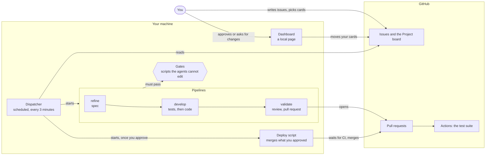

# Shipfloor

**A software factory for Claude Code.** You write a GitHub issue. Agents refine it into a spec, build it against failing acceptance tests, review it and open the pull request. You approve twice, and it ships. What passes is decided by deterministic gates the agents cannot edit, not by an agent saying it is done.

> The shop floor is where a factory's work gets done. This one ships software: the agents build; the gates hold.

Shipfloor is a Claude Code plugin and a set of Bash and Python scripts. It runs on your own machine, with your own Claude Code and GitHub accounts, against any repository that declares a `.shipfloor/factory.yml`. A local dashboard shows what waits for you, what is running, each run's log and what every card cost.

> [!NOTE]
> Nothing is hosted: the factory is a scheduled task on your machine that starts Claude Code sessions. It runs on Windows (Git Bash), macOS and Linux.

**In this README:** [A card's way to production](#a-cards-way-to-production) · [Architecture](#architecture) · [How it works](#how-it-works) · [Install](#install) · [Agent pool](#agent-pool) · [Cost limits](#cost-limits) · [Notifications](#notifications) · [Working hours](#working-hours) · [Parallel work](#parallel-work) · [Operation](#operation) · [Language](#language) · [Security](#security) · [Development](#development)

## A card's way to production

The board is a GitHub Project with ten fixed columns. You own the yellow ones: you move a card into them, or the factory leaves a card there for your decision. The factory works the dark ones.

```mermaid
flowchart LR
  inbox([Inbox]) -->|you pick it| rr([Ready for Refinement])
  rr -->|refine| tr[Technical Refinement]
  tr --> sr([Spec Review])
  sr -->|you approve the spec| rd([Ready for Dev])
  rd -->|develop| co[Coding]
  co --> va[Validation]
  va -->|validate| st([Staged])
  st -->|you approve the PR| rp([Ready for Prod])
  rp -->|deploy| done[Done]
  sr -.->|you ask for changes| rr
  st -.->|you ask for changes| co
  classDef owner fill:#f2c230,stroke:#8a6d00,color:#1a1a1a
  classDef factory fill:#22303f,stroke:#4d6177,color:#eef3f7
  class inbox,rr,sr,rd,st,rp owner
  class tr,co,va,done factory
```



You decide two things per card: whether the spec is what you want built, and whether the pull request ships. Everything between those two decisions runs without you.

## Architecture



- **Dispatcher.** A scheduled task that reads the board of every registered project and starts a pipeline for each card that is ready, within the machine's pool of sessions. It keeps no state of its own: the board is the source of truth.
- **Pipelines.** `refine`, `develop` and `validate` are Claude Code sessions started with `claude -p`. Each is a tech lead that calls role agents (product owner, UX, security, QA, engineers) and works in the card's own git worktree.
- **Gates.** Scripts that decide what passes: who may touch which files, that the acceptance tests failed before the code existed and pass after, that nobody edited them in between, that the build is green. They run from an installed copy outside every worktree and read the project's config from `origin/main`, so an agent cannot change the rules that judge it.
- **Deploy.** A script, not an agent. It brings the branch up to date with `main`, waits for CI on the head you approved and merges. An agent is called only to resolve a conflict or fix what broke on top of `main`, within small limits.
- **Dashboard.** A page served on `127.0.0.1`: what waits for you, live runs and their logs, the cost of each card from the tokens of its runs, and the review pages where you approve.

## How it works

The board (a GitHub Project v2) has fixed columns. The owner moves cards between the 👤 columns; the factory works the 🤖 ones:

| Pipeline | Takes from | Leaves in | What it does |
|---|---|---|---|
| `/sf:refine` | Ready for Refinement | Spec Review | PO, UX/UI and Cybersec write the spec; the Tech Lead writes architecture and test plan |
| `/sf:develop` | Ready for Dev | Validation | plan, failing acceptance tests (QA), implementation per layer |
| `/sf:validate` | Validation | Staged | gates, review (code, UX, security), PR with green CI |
| `/sf:deploy` | Ready for Prod | Done | up to date with `main` (resolving conflicts, fixing what breaks), merge tested on the current `main`, waits for CI and deploy; on failure opens a revert PR |

The gates (`scripts/gate.sh`) do not depend on the model: file scope per role, forbidden paths, untouched acceptance tests, immutable, unique and ordered migrations, build per layer, red by assertion (not by a compile error) and green with at least one test run. `build` and `green` reuse a pass the factory recorded for the same clean commit and inputs, say so in their output, and run again when anything differs.

A dispatcher (a scheduled task, every 3 minutes by default) goes through every registered project and starts pipelines with `claude -p`, within the machine's agent pool, each stage's slots and the project's WIP.

## Agent pool

Each pipeline run is one agent. `~/.shipfloor/config.yml` sets how many run at once on the machine, across all projects, and how many each stage may take (absolute numbers):

```yaml
pool: 4
stages: {refine: 2, develop: 2, validate: 2, deploy: 1}
```

`shipfloor pool` shows it and the runs in progress; `shipfloor pool set 6` and `shipfloor pool stage validate 3` change it. A project runs one deploy at a time (merges into main are serial); its `limits.<stage>.wip` in `factory.yml` caps the cards waiting in Spec Review (refine, default 2) and in Coding + Validation (develop, default 4).

## Cost limits

The same `~/.shipfloor/config.yml` can cap what a card and a day spend. All three keys are optional, in US$, and a key you leave out does nothing:

```yaml
costs: {card_warn: 20, card_block: 40, day_stop: 80}
```

- `card_warn`: a card whose estimate passes it is flagged on the dashboard. Nothing stops.
- `card_block`: past it, the card's next run does not start. The card gets the `blocked` label and a comment with the estimated total and the estimate per stage, and waits for your call. Unblocking it grants one more `card_block`, counted from the unblock.
- `day_stop`: when today's estimate across every project passes it, no new run starts and the dashboard says so. Sessions already running finish. Runs start again on their own when the machine's local day changes.

The figures are an estimate, from the tokens of the runs and `~/.shipfloor/prices.yml`, not a bill. A card that ran on a model with no price has an unknown estimate: no card limit flags or blocks it, its runs add nothing to the day, and the dashboard says the price is missing. The dashboard's Settings, Costs section sets the three values (an empty field removes one; `card_warn` cannot be above `card_block`), and a change applies from the next dispatcher cycle.

The same file picks the model each stage's session and each agent runs on, in two optional maps:

```yaml
models:
  stages: {develop: sonnet}   # refine, develop, validate, deploy
  agents: {engineer: haiku}   # a plugin agent, or the agent a project's layer names
```

A model is `opus`, `sonnet`, `haiku` or `fable`. A stage or agent left out keeps the model the plugin ships with (validate and deploy on Sonnet, refine and develop on Claude Code's default, each agent on its frontmatter model). A bad model or name does not stop the factory: `shipfloor doctor` warns about it, the run uses the shipped model, and the dashboard's Settings section "Agents and models" edits it, with the average cost per card of the last 7 days next to each stage.

## Notifications

The factory tells the owner when it needs them, so the dashboard does not have to be open. At the end of each dispatcher cycle it sends, once per wait:

- a card waits in Spec Review or Staged;
- a run is blocked (the message says the stage it stopped in);
- one reminder for a wait that lasts `reminder_min` minutes, and no more;
- the factory is stuck: the Claude usage limit was hit, a project is skipped, or no card moved for an hour in a project with cards at work and nothing paused;
- optionally (`done`, off by default), a card reached production.

A card that leaves its state and comes back waits anew and is told again. There are two channels: a Windows toast on this machine, and a phone push through [ntfy.sh](https://ntfy.sh), which is off until a topic is set. A message that one channel delivered counts as told. Quiet hours hold what is new; when they end, one notification lists what still waits. While `config.yml` is invalid, nothing is sent.

Set it in the dashboard's Settings > Notifications, or by hand in the `notify` block of `~/.shipfloor/config.yml` (these are the defaults):

```yaml
notify:
  events: {waiting: true, blocked: true, reminder: true, stuck: true, done: false}
  channels: {toast: true, ntfy: false}
  ntfy_topic: ""        # letters, digits, - and _, up to 64
  reminder_min: 60      # 15 to 720
  quiet: ""             # "HH:MM-HH:MM", for example "22:00-07:00"; the two times differ
```

To get the push, pick a topic that is long and random: anyone who knows the topic can read its notifications. Put it in `ntfy_topic`, turn `channels.ntfy` on, and subscribe to the same topic in the ntfy app on the phone. The push carries only the project and the card's number, title and state.

## Working hours

`hours` in `~/.shipfloor/config.yml` lists the windows (local time, 24-hour `HH:MM-HH:MM`, start included, end excluded) in which the dispatcher starts runs. Outside them it does everything else (board snapshot, reaping, retries) but starts nothing; runs in progress finish. A window whose end is before its start crosses midnight. Unset or `[]` means all hours; a malformed value is reported by `machine validate` and ignored.

```yaml
hours: ["08:00-23:00"]
```

## Parallel work

Cards built at the same time do not break `main`:
- the `migration` gate refuses a version used twice and a migration older than the base's or `main`'s;
- only `deploy` merges `origin/main`, once, on the head the owner approved (`validate` does it only when the PR conflicts with main, so CI can run); the PR's CI already tests the branch merged with main;
- `deploy` merges only a head that contains the current `main` and passed CI; with `deploy.refresh_staged: true` the dispatcher also keeps Staged PRs on top of `main` (faster approvals, but every refresh reruns CI: leave it off when Actions minutes are tight);
- a project with no CI on GitHub (or no Actions minutes to spend) sets `deploy.local_ci` to a command: the deploy runs it in the card's worktree on the head merged with main, where it would wait for GitHub's checks. Red gets the same fix rounds as red CI, and `deploy.timeout_min` bounds it. With it set, `deploy.required_checks` is not read and validation does not wait for checks;
- to close the race with merges made by hand, enable branch protection on the main branch with "Require branches to be up to date before merging" and required CI; `/sf:deploy` reports when it is missing.

On deploy, what breaks on top of `main` is repaired in place. Conflicts are resolved by an agent, which may touch only the conflicted files. A migration whose version `main` took is renumbered above main's newest. A gate or CI that goes red after the merge gets up to two agent rounds: a fix within `deploy.fix_max_files` / `fix_max_lines` (3 files, 40 lines) that touches no acceptance test ships with the approved head, recorded on the issue as `deploy-fix`; a larger one goes back to Staged for a new approval. A CI run on `main` that fails has its failed jobs run once more before the revert. The card goes back to Coding only when a migration file itself conflicts, when the conflict is large (`deploy.conflict_max_files` / `conflict_max_hunks`), or when the two rounds do not turn it green.

## Requirements

`git`, an authenticated `gh`, `claude`, Python 3.11+ with PyYAML (`pip install pyyaml`), and Git Bash on Windows.

## Install

```bash
claude plugin marketplace add <path or URL of this repo>
claude plugin install sf@shipfloor
bash <plugin>/scripts/shipfloor install     # copies scripts and templates to ~/.shipfloor/factory, each file by rename (safe while runs are in progress) and says how many it replaced, added and removed; refuses a clone that is not a clean, up-to-date main (--force installs anyway and says so)
alias shipfloor='bash ~/.shipfloor/factory/shipfloor'
shipfloor doctor
```

For each repository:

1. Copy `examples/factory.yml` to `.shipfloor/factory.yml`, set project, board and layers, and commit it to the main branch.
2. `shipfloor add <local clone> [--worktrees DIR]` reads the config from `origin/main`, validates it and registers the project.
3. `shipfloor setup-board <project>` creates the columns and the `ui`, `cybersec` and `blocked` labels.
4. Optionally add `.shipfloor/review-criteria.md` and project agents in `.claude/agents/<name>.md`, referenced by `agent:` in a layer.
5. Permissions for the headless pipelines in the project's `.claude/settings.json`: `Bash(bash ~/.shipfloor/factory/gate.sh:*)`, `Bash(bash ~/.shipfloor/factory/board.sh:*)`, `Bash(bash ~/.shipfloor/factory/shipfloor-config.sh:*)`, `Bash(bash ~/.shipfloor/factory/report.sh:*)`, `Bash(bash ~/.shipfloor/factory/review-page.sh:*)`, plus `git` and `gh`.

Dispatcher on Windows: `powershell -File <plugin>/installer/install-dispatcher.ps1` registers the `ShipfloorDispatcher` task. It runs every 3 minutes unless you choose 1, 5 or 10: pick it in Settings in the dashboard ("Looks for work every"), or pass `-EveryMin` to `installer/install-dispatcher.ps1`. The value lives in `~/.shipfloor/config.yml` as `dispatcher.every_min`.

Dispatcher on Linux and macOS: `bash <plugin>/installer/install-dispatcher.sh` registers it. On Linux it is a systemd user timer when there is a systemd user session, else a crontab line. On macOS it is a launchd user agent. To remove it, run `bash <plugin>/installer/install-dispatcher.sh --uninstall`.
- On systemd the dispatcher stops at logout unless lingering is on (`loginctl enable-linger <user>`); the installer says which.
- The pace comes from `--every-min` or `dispatcher.every_min`. To change it, run the installer again. The dashboard's pace control is Windows only.
- The installer records your shell's `PATH` for the timer. Run it again after PATH changes.

## Upgrading from Aghanim's Anvil <!-- legacy aghanim -->

The factory was called Aghanim's Anvil (`aghanim`) before 0.7.0. To move a machine and its repositories: <!-- legacy aghanim -->

1. `aghanim pause` and wait until `aghanim pool` shows no runs. <!-- legacy aghanim -->
2. Install the new plugin (`claude plugin install sf@shipfloor`), then `bash <plugin>/scripts/shipfloor migrate-home` (moves `~/.aghanim` to `~/.shipfloor`) and `shipfloor install`. <!-- legacy aghanim -->
3. Run `installer/install-dispatcher.ps1` again: it replaces the `AghanimDispatcher` task with `ShipfloorDispatcher`. <!-- legacy aghanim -->
4. In each repository, move `.aghanim/` to `.shipfloor/` and update anything that calls `~/.aghanim/factory/` or `/aghanim:*` (project agents, `.claude/settings.json`, `factory-guard.yml`). There is no fallback: a repository is not read until it has `.shipfloor/factory.yml`. <!-- legacy aghanim -->
5. `shipfloor resume`.

## Operation

`shipfloor dashboard` · `shipfloor list` · `shipfloor pool` · `shipfloor pause [project]` · `shipfloor resume [project]` · `shipfloor remove <project>` · `shipfloor metrics <project>` · `shipfloor clean <project>` · `shipfloor accept <project> <n> <reason>` (owner only: after reviewing how a card's acceptance test files changed since the QA commit, for example a merge from main resolved by hand, take them as they stand; `acceptance-intact` then passes those exact contents, recorded in `~/.shipfloor/projects/<project>/accepted.tsv`, and blocks again on any later edit). Before it comes to that, a card's own QA gets the first word: an engineer who finds an acceptance test wrong reports it instead of editing it, and when `acceptance-intact` fails on the card's own edit the Tech Lead sends the test back to QA, who either corrects it or puts it back and says what the code must do. QA's correction is a new QA commit, which becomes what the gate protects, and `gate.sh qa-amend <n>` keeps it honest without anyone reviewing it first: it touches only test files, loses no assertion line, switches no test off, and a card is amended at most twice. The amendment is commented on the issue and listed in the report.
`shipfloor dashboard` (or `/sf:dashboard` inside Claude Code) opens a local page with the pool, live runs, logs (per card, and a Feed view with every run, what it left behind and the dispatcher's log in one timeline), the estimated cost of each card and the review pages, where Spec Review and Staged cards are approved or sent back. Its address carries a random token; `--token <text>` fixes it instead. The In progress panel lists every card in the factory's hands: the sessions at work and, marked as waiting with the reason (a busy stage slot, a pause), the cards that wait for a run. Every panel, and every running session, has a maximize button in its corner that opens it over 90% of the screen: the lifecycle line becomes a board with each card by name in two lanes (upstream, to an approved spec; downstream, to production), and Today lists the day's runs one by one. What waits for you, maximized, is a decision inbox: the queue with the oldest wait first, what to read to decide the card in focus (the spec's problem, acceptance criteria and open questions from its review page; a pull request's size and checks; a block told in order: the step it stopped at, why, how the acceptance tests changed since QA wrote them, what the factory tried) and the decision as options that each say when to choose them and where the card goes next. A blocked card can be retried, sent back to Coding with a note, or, when `acceptance-intact` stopped it, have its tests taken as they stand (`shipfloor accept`). A decision waits five seconds so it can be undone. The Settings view changes this machine's limits (the pool, each stage's slots, the stacks; saved to `~/.shipfloor/config.yml` and read on the next cycle) and pauses the factory or one project at once; For a project it also sets how the factory operates on it on this machine (cards in progress and specs in refinement at once, how long the deploy waits, the largest conflict an agent may resolve): these are kept in `~/.shipfloor/projects/<project>/overrides.yml`, which every config reader lays over the project's `factory.yml`, and nothing else can be overridden there. What a project is (its files, layers and commands) is shown as the dispatcher last read it, with the file to edit in its repository. A card's Live tab shows its latest session as it happens (what the run and its subagents say and do) and, while a run works on the card, takes a message for it: the run and each of its subagents read the message after the tool call they are in (a hook the plugin ships, `hooks/hooks.json`), and no run ever waits for one.

The dashboard link's secret is kept in `~/.shipfloor/dashboard.token`, so a link from an earlier run still opens the dashboard after a restart; deleting that file and restarting makes a new link (the old one is then refused).
Logs in `~/.shipfloor/logs/dispatcher.log` and `~/.shipfloor/projects/<project>/logs/`. A layer may set `install` (for example `pnpm install --frozen-lockfile`): the gates run it in the layer's directory before its build or tests, once per content of that directory, so no agent has to install a worktree's dependencies; a failing install is exit 3 (infrastructure). A project the dispatcher cannot use in a cycle (its control checkout does not reach `origin/<main>`, or the config there is missing or invalid) is skipped: the reason and the time of the first failed cycle go to `~/.shipfloor/projects/<project>/SKIPPED`, the dashboard shows a "skipped since" flag and `shipfloor doctor` warns; the first good cycle clears it. An `index.lock` older than 10 minutes in the control checkout (`SHIPFLOOR_STALE_LOCK_MIN`) is treated as left by a dead git and removed. Reports on each repository's orphan `factory-reports` branch. At the end of every cycle the dispatcher empties what cards left under the project's `tmp/`: the `tmp/<n>/` of a card that is Done or off the board, and stray files or folders beside them once nobody touched them for 3 days, unless their name carries the number of a card still in progress (`shipfloor clean <project>` does the same on demand).

Every dispatcher cycle appends one line to `~/.shipfloor/logs/health-<YYYY-MM>.jsonl`: each project's cards per column and blocked cards, runs against the pool and the stage slots, busy stacks, the machine's CPU, free memory and free disk, and how the cycle went (seconds, exit code, whether another cycle was still running). The dashboard and `shipfloor doctor` raise what the last three cycles show: a stage with a free slot and cards waiting through all three, more runs than a limit, two cycles at once.

The demo: `bash scripts/test/demo-stack.sh up` serves this checkout's dashboard on sample data (two projects, every kind of card and run) and prints its address, `http://127.0.0.1:<port>/?t=<token>`; `down` stops it and removes its files.
It reads only `SHIPFLOOR_STACK` (default `shipfloor-demo`), `SHIPFLOOR_PORT_WEB` (7727) and `SHIPFLOOR_DEMO_TOKEN` (`demo`), never touches `~/.shipfloor` and never calls the real `gh`, so a card that changes the page can be looked at without a factory home.

## Language

The factory speaks English unless told otherwise. Two keys change that, each `en` (default) or `pt-BR`:

- `language` in a project's `.shipfloor/factory.yml`: what people read about that project. The agents write specs, comments, reports and review pages in it; the gates' messages and what the deploy logs and posts on the card come out in it.
- `language` in `~/.shipfloor/config.yml`: this machine. The dashboard and the dispatcher's own log lines. It can also be set in Settings > Language, which shows each project's language too (read-only).

What other code reads stays in English whatever the language: commit messages, the spec's `##` headings, the markers on a card (`staged-head:`, `deploy-merge:`, `deploy-fix:`, "Factory report"), labels, and the board's column names on GitHub (the dashboard shows them translated). The scripts and the page are written in English and translated where their text leaves them, by the catalogs in `scripts/lang/` (`<code>.sed` for the scripts, `dashboard.<code>.json` for the page): a phrase with no entry there comes out in English, and a new language is a new pair of files plus its code in `LANGS` (`scripts/shipfloor_config.py`).

## Security

- Scripts run from the installed copy in `~/.shipfloor/factory`, outside every worktree.
- The gates read a snapshot of the committed config (`origin/main`), outside the pipelines' reach; `.shipfloor/` is forbidden to agents, so a factory PR cannot change the gates that judge it.
- `templates/factory-guard.yml` repeats the forbidden-path check in GitHub Actions.
- The agents read an issue's title and body, and only the comments written by the factory's own GitHub user: on a public repository anyone can comment, and a comment would be an instruction. To listen to more people, name them in `.shipfloor/factory.yml`: `trusted_commenters: [alice, bob]` (`['*']` is anyone; only for a private repository). The setting is read from `origin/main`, where no agent can change it.

## Development

`bash scripts/test/run.sh` runs the suite; `bash scripts/test/run.sh --changed` runs only the tests tied to what changed against `origin/main` (use it while editing, and the whole suite before a push). Designs in `docs/superpowers/specs/`.
