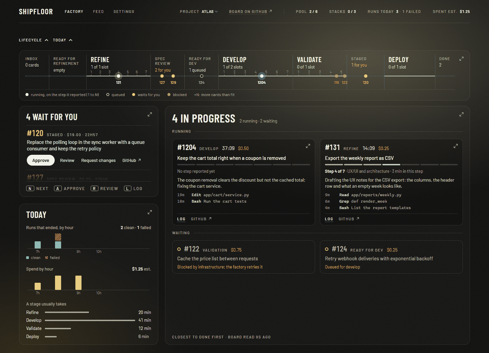

# Shipfloor

**A software factory.** Write a GitHub issue, approve twice, and it ships.



Shipfloor turns the issues on a GitHub board into merged pull requests. Agents write the spec, the failing tests, the code and the review. You make two decisions per card: is this the spec you want built, and does this pull request ship.

What passes is decided by scripts the agents cannot edit, so "done" is never an agent's word for it.

It is a Claude Code plugin that runs on your own machine, with your own Claude Code and GitHub accounts. Nothing is hosted.

## How a card ships


The yellow columns are yours; the factory works the dark ones.

1. **You pick an issue** and move it to Ready for Refinement.
2. **The factory writes the spec.** Product owner, UX, security and tech lead agents each write their part. You read it and approve, or ask for changes.
3. **The factory builds it.** QA writes acceptance tests that must fail first. Engineers implement until they pass. A review opens the pull request.
4. **You approve the pull request.** The deploy brings it up to date with `main`, waits for CI and merges.

## Why you can leave it running

- **Gates, not promises.** A card moves on only when scripts say so: the acceptance tests failed before the code existed and pass after, nobody edited them in between, and each role touched only its own files.
- **The rules are out of reach.** The gates run from an installed copy and read the project's config from `main`. A card cannot change what judges it.
- **You see what it costs.** Every card shows an estimate from the tokens of its runs. Optional limits flag a card, block it, or stop the day.
- **It calls you when it needs you.** A desktop notification or a phone push when a card waits for your decision or a run is blocked.
- **It listens to you only.** On a public repository anyone can comment on an issue. The agents read your comments and nobody else's.

## The dashboard

`shipfloor dashboard` opens a local page with what waits for you, what is running and at which step, each run's log and what each card cost. You approve specs and pull requests there, with the review beside the decision.

It comes with twelve themes, in twelve languages: English, Simplified and Traditional Chinese, Spanish, Japanese, German, French, Brazilian Portuguese, Russian, Korean, Italian and Turkish.

## Quick start

You need Python 3.11+ with PyYAML, Git, an authenticated gh, Claude Code (`claude`), and Git Bash on Windows for the wrappers and the scheduler.

First add the Shipfloor plugin to Claude Code (a marketplace add and a plugin install, two commands: see [docs/install.md](docs/install.md)). The plugin brings the `shipfloor` script. Then, for the repository the factory should work on:

```bash
bash <plugin>/scripts/shipfloor init <repo>       # add --yes to confirm every question
```

`shipfloor init` checks the prerequisites before it changes anything, then runs each step that is not done yet: it installs the factory, writes `.shipfloor/factory.yml` (committed to main after you confirm), registers the repository, sets up the board, registers the dispatcher and runs `shipfloor doctor`. Every step prints the `$ <command>` it is equivalent to. Run it again at any time: finished steps are skipped. Without a terminal and without `--yes` it prints the command that needs you and exits 1.

> [!NOTE]
> The manual steps are in [docs/install.md](docs/install.md). The dispatcher is registered by `powershell -File <plugin>/installer/install-dispatcher.ps1` on Windows and `bash <plugin>/installer/install-dispatcher.sh` on Linux and macOS; `install-dispatcher.sh --uninstall` removes it. On Linux with systemd, turn lingering on so it survives logout, and run the installer again after PATH changes.

Move a card to Ready for Refinement and open the dashboard.

## Architecture

<details>
<summary>The pieces and how they talk</summary>


- **Dispatcher.** Reads the board of every registered project and starts a pipeline for each card that is ready. The board is the source of truth; the dispatcher keeps no state of its own.
- **Pipelines.** `refine`, `develop` and `validate` are Claude Code sessions. Each is a tech lead that calls role agents and works in the card's own git worktree.
- **Gates.** The scripts that decide what passes.
- **Deploy.** A script, not an agent. An agent is called only to resolve a conflict or fix what broke on top of `main`, within small limits.
- **Dashboard.** A page served on `127.0.0.1`.

</details>

## Learn more

| | |
|---|---|
| [How it works](docs/how-it-works.md) | The four pipelines, the gates, how parallel cards stay off each other's toes, and what keeps it safe |
| [Install](docs/install.md) | Requirements, setting up a repository, the dispatcher on each system |
| [Configuration](docs/configuration.md) | The agent pool, cost limits, models, notifications, working hours and language |
| [Operation](docs/operation.md) | The commands, the dashboard, logs and health, and running the tests |
